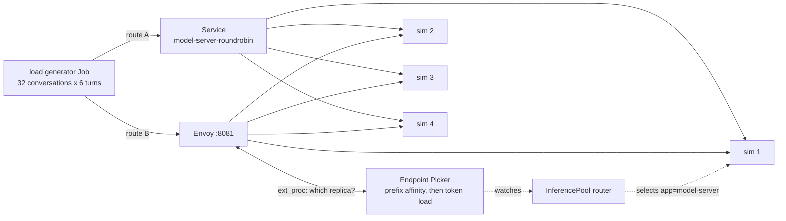

# kubernetes-llm-inference-gateway

[](https://github.com/heyvaldemar/kubernetes-llm-inference-gateway/actions/workflows/e2e.yml)
[](https://scorecard.dev/viewer/?uri=github.com/heyvaldemar/kubernetes-llm-inference-gateway)
[](https://opensource.org/licenses/MIT)

LLM requests are not ordinary HTTP requests. A chat or an agent resends its whole conversation on every turn, so most of each prompt is a prefix some model server has already processed and may still hold in its KV cache. A load balancer that spreads requests evenly sends most turns to a replica that has not seen the conversation, and that replica processes the whole prefix again.

This repository measures what routing by cache is worth on Kubernetes, with the llm-d router (llm-d 1.0) and the Gateway API Inference Extension, against a plain round-robin Service in front of the same model servers, under the same load, on every push and every day.

## What it measured

The same 32 conversations of 6 turns, 16 at a time, each with a system prompt of its own, through each route to the same four model servers. Local run on kind, 2026-10-30, three rounds; the CI run on a fresh runner re-measures every day.

| | Round-robin Service | llm-d router |
|---|---|---|
| Time to first token, median | 675–677 ms | 94–96 ms |
| After the first turn, median | 267–275 ms | 92–94 ms |
| After the first turn, 90th percentile | 889–917 ms | 105–107 ms |
| Prompt tokens found in a replica's prefix cache | 40–43% | 79% |
| Time for the whole load | 8.3–9.0 s | 4.2–4.3 s |

The first turn of a conversation has nothing cached anywhere, so it costs the same on both routes; every later turn is where the routes differ. The router sends each conversation back to the replica that holds its prefix, so 79% of prompt tokens are found in cache, close to the most this load allows (about 82%, since the first turn of each conversation has nothing to find), against 40–43% when the replica is picked at random.

**Most of the gain came from going back, not from reading the prompt.** With llm-d's prefix-cache affinity filter removed and only its token-load scorer left, the router still found 74–76% of prompt tokens in cache, at 0.35–0.41 of round-robin's time to first token. The turns of a conversation arrive one at a time, and the replica that has just answered one is, at that moment, the least loaded, so load-based picking sends the next turn back to it. Picking a replica at random takes the router back to round-robin's numbers (41–42% of tokens in cache, 1.12–1.27 of its time). The affinity filter is what keeps a conversation on its replica when that replica is not the least loaded; under this load it adds 3 to 5 points of cache hits (79% against 74–76%).

**What these numbers are about.** The model servers are simulated (below), so the numbers measure the routing, not a model. The simulator charges 1 ms of prefill per uncached token and 10 ms per output token; a GPU with faster prefill gains less time from each cache hit, a longer shared prefix gains more. The ratio is what transfers; the milliseconds come from the weekly GPU run, which is not built yet.

## How it works



- **Model servers**: four replicas of [`llm-d-inference-sim`](https://github.com/llm-d/llm-d-inference-sim) v1.0.0. It speaks vLLM's OpenAI API and metrics, keeps a prefix KV cache per replica, and charges prefill time only for the prompt tokens that cache does not hold, so a request on the right replica answers sooner for the same reason it would on a GPU, with nothing random in it.
- **Round-robin**: a Kubernetes Service in front of the same four; kube-proxy picks a replica at random for each connection.
- **The llm-d router**: [`llm-d-router-standalone`](https://github.com/llm-d/llm-d-router) v1.0.0, an Envoy proxy that asks the Endpoint Picker over ext_proc which replica of the `InferencePool` gets each request. Its plugins are llm-d's optimized-baseline: prefix-cache affinity, then the replica with the least prefill work queued. Requests for CPU and memory are cut from the chart's production defaults to fit a kind node; the scheduling is unchanged.
- **The load**: [`loadgen/loadgen.py`](loadgen/loadgen.py), standard-library Python, run as a Job inside the cluster. Each conversation resends its full history on every turn, every request streams, and the time to the first content token is measured where a user waits for it. A stream that ends without its `[DONE]` counts as a failure.
- **The cache hits** are the model servers' own counters, `vllm:prefix_cache_hits_total` over `vllm:prefix_cache_queries_total`, read before and after each run.

The reasoning is in three decision records: why the simulator before the GPU ([ADR 1](docs/decisions/0001-measure-routing-on-simulated-model-servers.md)), why a plain Service is the baseline ([ADR 2](docs/decisions/0002-the-baseline-is-a-plain-service.md)), and why the load resends its history and is measured at the first token ([ADR 3](docs/decisions/0003-a-load-that-resends-its-history.md)).

## How it is proven

`tests/e2e.sh` runs the load four times, round-robin and router alternating, each with conversations no cache has seen, and requires:

- every request answered, on both routes;
- through the router, a median time to first token after the first turn of at most 0.6 of round-robin's, in every round;
- through the router, a cache hit rate at least 20 points above round-robin's, in every round.

Each check is shown the break it exists for (`tests/plants.tsv`, run in CI): the router picking a replica at random, model servers with no prefix cache, an `InferencePool` that selects no model server, a "baseline" that is the router itself, and a threshold no honest run can meet. Each must fail the test.

## Quickstart

```bash
./scripts/up.sh       # kind, the InferencePool CRD, four model servers, the router
./tests/e2e.sh        # the comparison; RESULTS=<dir> keeps each run's JSON
./scripts/run-load.sh router http://router-epp:80 any-seed --sessions 64 --turns 8
kind delete cluster --name ilg    # teardown
```

Needs Docker, kind, helm and kubectl. Every image is pinned by digest in [`images.lock`](images.lock).

## What it costs

Nothing beyond a machine with Docker: the cluster is kind, the model servers are simulated, and nothing reaches a cloud account. One test run takes about four minutes on a GitHub runner; the planted breaks take about fifteen more.

## What it does not do

- **No GPU yet.** The weekly run on an NVIDIA L4 with vLLM and a real model, with cost per million tokens, is the next step; until it exists, nothing here is a claim about a GPU.
- **One router configuration.** llm-d's other paths (precise prefix-cache routing over KV events, prefill/decode disaggregation, predicted-latency routing) are not exercised.
- **Not production.** It is a reference: it runs on kind, on a laptop or a CI runner, at no cloud cost.

## Questions, bugs and changes

Open an [issue](https://github.com/heyvaldemar/kubernetes-llm-inference-gateway/issues). Security reports go privately, as [SECURITY.md](SECURITY.md) describes.

## License

[MIT](LICENSE).
